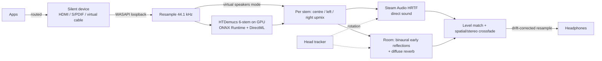

# Spatiall

Live spatial audio for headphones on Windows 10/11. Spatiall taps what your apps play, splits music into
drums / bass / guitar / piano / other instruments / vocals (or voices vs. music in videos) with an on-device neural
network, and places each part in a virtual room around your head. Head tracking keeps the room still when you turn.
One hotkey toggles it; layouts switch from a see-through quick menu.



## Requirements

- Windows 10 2004+ or Windows 11, x64. One exe; per-app routing picks the right undocumented interface for the
  running build (Windows 10 ≤ 21H2 vs. Windows 11).
- DirectX 12 GPU for Stems mode (tested: GTX 1080 Ti, ~125 ms per separation step). Falls back to CPU, which is
  too slow for live use.
- Headphones.
- **A second, unheard playback device** (the "silent device"). Apps are routed into it and Spatiall records it.
  Any of these works: a monitor's HDMI/DisplayPort audio output with nothing listening, an unused S/PDIF output,
  or a virtual cable such as VB-CABLE. Whatever you pick must not be connected to speakers you can hear.

## Using it

The window has the **Stage** (drag orbs to place instruments; the arc shows each one's left/right spread) and a
panel with **Mix · Layouts · Room · Headphones · Sources · Advanced**.

1. **Headphones** tab: pick your headphones and the silent device (auto-picked on first run).
2. **Sources** tab: pick a mode and capture the *Whole system* or only *Selected apps*.
   - *Adaptive* (default): stems for music; switches itself to the low-latency path (≈75 ms, voices still in
     front) while a **video** or **game** plays, or while the GPU is too busy to separate in time (retries stems
     after 30 s). Each trigger can be turned off.
   - *Stems*: always separate (≈1 s delay).
   - *Virtual speakers*: never separate (≈60–75 ms).
3. **Power on**. Place instruments, pick a **Room** (Studio is a good default; *Off* = direction only, which tends
   to sound inside your head).

| Control | Effect |
|---|---|
| `Ctrl+Alt+S` / tray "Spatial audio" | Crossfades between spatial and plain stereo (seamless, same latency) |
| `Ctrl+Alt+P` / tray "Power" | Starts/stops Spatiall and gives the apps their original output back |
| `Ctrl+Alt+Space` (hold) | Quick menu: see-through layout picker at the mouse; click, press 1–9, or let go over a layout |
| Per-layout hotkeys | Set in the Layouts tab; switch layouts from anywhere (also works over fullscreen games) |
| `Ctrl+Alt+C` / tray | Recenter head tracking |
| Close window | Hides to the tray; Exit from the tray menu or the window footer |

### Layouts

Built-in layouts (Stage, Surround, Wide, Video: voices front, music around) adapt to whatever instruments the model
separates. *Save current placement* stores your own (by instrument name, so a layout made with the 6-stem model
still works with the 4-stem one); `···` updates, renames or deletes it. Switching animates over ~350 ms. Custom
layouts live in `%LOCALAPPDATA%\Spatiall\layouts.ini`.

### Head tracking

Saved per headphones. Sources:

- **Headphone sensor**: headphones that expose the Android head-tracker HID sensor (e.g. Sony WH-1000XM5/XM6,
  WF-1000XM5) are read directly.
- **Phone, webcam or OpenTrack (UDP)**: OpenTrack "UDP over network" (and FreePIE UDP) on port 4242. The panel
  shows this PC's address to send to. OpenTrack itself turns a webcam or phone into a tracker.

Bluetooth adds output delay; *Prediction* turns the sound slightly ahead of your head to hide it (defaults to
100 ms for Bluetooth headphones). If turning feels reversed, use the invert boxes.

#### AirPods head tracking

Windows cannot read AirPods' motion sensors: Apple only exposes them to iPhone/iPad/Mac, and the data rides a
Bluetooth channel Windows apps can't open. Working routes, all sending OpenTrack UDP to Spatiall:

- **iPhone/Mac relay app** (e.g. *Smart Head Track for OpenTrack*, *HeadTrack*, *AirTracker* on macOS). Caveat:
  AirPods only report motion while they are that iPhone/Mac's active audio output, so this works when the audio
  plays through the Apple device, not straight from the PC.
- **Linux bridge** (`pods-head-tracker` on e.g. a Raspberry Pi): reads AirPods motion over BlueZ; PC audio goes
  through the bridge.
- **`airpods-head-track` + MagicAAP driver** on Windows: intended to read motion while the PC plays to the AirPods,
  but needs a test-signed kernel driver; untested here.

### Headphone checks

The Headphones tab shows how the selected headphones are connected. It warns when Windows has switched Bluetooth
headphones into hands-free (headset/mic) mode: that mode is mono, low-quality audio, so spatial audio can't work —
pick the "… Stereo" device or close the app using the headset microphone.

Routing changes are journaled in `%LOCALAPPDATA%\Spatiall\routing-journal.txt` before they are made; if Spatiall
crashes or is killed, the next launch restores your devices. Log: `%LOCALAPPDATA%\Spatiall\spatiall.log`.

### Latency and video

Stems need future context, so audio arrives ~1 s late — fine for music, too late for lip sync (~100 ms), and no
setting of the separator gets there. So *Adaptive* mode prefers latency over separation while video or a game is
playing: it switches to the low-latency path, where the centre/side upmix still keeps dialogue (mixed to the centre
in films and videos) in front and spreads music and ambience around (measured 72–82 ms).

Video is detected from what is producing sound, because Windows' media info can't tell (Chromium reports every tab
as music): a known video player playing audio (VLC, mpv, MPC, PotPlayer, Kodi, Plex, Netflix, …), or a browser
playing audio with a visible, non-minimised window showing a video site (YouTube but not YouTube Music, Netflix,
Twitch, Prime Video, Disney+, …). The list is editable under *Advanced → Video detection*. A minimised YouTube tab
counts as background listening and keeps stems. Players with an audio delay offset (VLC, mpv, MPC-HC) can
alternatively compensate the stems delay with about −1000 ms.

The **hop** (how often the separator runs) adapts on its own: when a run takes more than ~60% of the hop (busy
GPU) the hop grows immediately, up to 0.8 s, and creeps back to the *Hop* setting in *Advanced* once there is
headroom. The *Hop* setting is therefore the shortest step, i.e. your preferred latency.

## How the spatial rendering works

- **Centre/side upmix per stem**: content common to both channels becomes one source at the orb; only genuinely
  wide content goes to the left/right ends of the arc. (Rendering both channels as separate sources sends centred
  sound to each ear twice and measured 3–5 dB of comb-filter ripple.)
- **Room**: 8 binaural early reflections from fixed room directions plus an 8-line feedback-delay-network tail.
  Direct sound falls off with distance while the room level stays, so distance is heard as direct-to-room ratio.
- **Head tracking** rotates the direct sound and the reflections together, so the whole room stays put.
- **Level matching** keeps the spatial mix as loud as plain stereo, so toggling never jumps.
- **Adaptive playback cushion**: separated audio arrives in chunks, each up to one GPU run late. The buffer
  follows the separator's recent worst run time, grows immediately after an underrun (logged as
  `audio underrun …`) and gives the latency back slowly once things are stable. The model is warmed up at load so
  its slow first run never happens mid-stream.

## Measured on the development machine (GTX 1080 Ti, Windows 10 19045)

Streaming separation quality vs. offline Demucs (SDR, dB; `tools/eval_streaming.py`):

| Model | Look-ahead | drums | bass | other | vocals | GPU time / step |
|---|---|---|---|---|---|---|
| 7.8 s, 4 stems (`htdemucs.onnx`) | 0.25 s | 14.8 | 17.6 | 16.9 | 7.1 | ~290–490 ms |
| 4 s, 4 stems (`htdemucs_4s.onnx`) | 0.25 s | 13.8 | 16.1 | 16.3 | 6.5 | ~130 ms |
| 4 s, 6 stems (`htdemucs_6s_4s.onnx`, default) | 0.3 s | 8.5–23.9 | 10.9–19.7 | 9.9–16.1 | — | ~125 ms |
| 2 s, 4 stems (not shipped) | 0.25 s | 11.1 | 13.5 | 13.6 | 3.6 | ~80 ms |

The 6-stem row spans two test tracks. Guitar/piano/vocal SDRs are not meaningful on tracks where those stems sit
30–50 dB below the mix.

End-to-end (`spatiall_enginetest`): stems 979–1030 ms, virtual speakers 54–67 ms; spatial vs. stereo loudness
within 1 dB. `spatiall_selftest`: C++ separation matches the reference at 73–99 dB SNR; HRTF +90° ILD 17 dB; head
rotation keeps a source room-fixed within 0.1 dB; upmix puts 100% of centred content in the centre source; Studio
room RT60 0.28 s.

## Building

Requires Visual Studio 2022 Build Tools (Desktop C++), CMake ≥ 3.26 and Ninja.

```bat
rem optional: keep the ~1 GB build tree off a small system drive
set SPATIALL_BUILD_DIR=D:\spatiall-build
build.cmd Release
```

CMake downloads pinned dependencies: Dear ImGui 1.93.0, pocketfft, libsamplerate 0.2.2,
ONNX Runtime DirectML 1.24.4 + DirectML 1.15.4, Steam Audio 4.8.1, JetBrains Mono 2.304 (OFL). The exe, DLLs,
`models\` and `fonts\` are placed in `<build>\Release\`. Set `SPATIALL_VSDEVCMD` to `VsDevCmd.bat` if `vswhere`
can't find Visual Studio.

### Models

`models/*.onnx` are HTDemucs v4 (Meta, MIT) exported with STFT/iSTFT moved out of the graph; the C++ side
(`src/sep/HtDemucs.cpp`) reproduces `HTDemucs._spec/_ispec` exactly. They are too large for git (112–174 MB), so
they are attached to the [v0.1.0 release](https://github.com/shrimpsooup2/SpatiAll/releases/tag/v0.1.0): put them
in `models\` before building (the build copies `models\` next to the exe; the `.json` files are in the repo). To
re-export instead (Python 3.11, `torch`, `demucs`, `onnx`, `onnxruntime-directml`):

```bat
python tools\export_htdemucs.py --model htdemucs_6s --segment 176128 --out models\htdemucs_6s_4s.onnx --check
```

`--segment` must be a multiple of 1024 (or 343980, the training length). The UI adapts to the sources listed in
the model's `.json`.

DirectML note: with ONNX Runtime's default whole-graph fusion, DirectML returns garbage for HTDemucs (also reported
upstream). Spatiall disables fusion (`ep.dml.disable_graph_fusion`) and verifies DirectML against the CPU once per
GPU/driver/model (`%LOCALAPPDATA%\Spatiall\dml-check.txt`), falling back to CPU on mismatch.

### Developer checks

- `spatiall_selftest <model.onnx> <dir> [cpu|dml|auto]` — C++ separation parity against the NumPy/ONNX reference
  (data from `tools/make_selftest_data.py`), spatial invariants (HRTF, head rotation, upmix, room decay),
  streaming continuity.
- `spatiall_enginetest pipeline <sink> <out> <mix.f32> <model.onnx> [stems|speakers]` — plays music into `<sink>`,
  runs the engine to `<out>` (device-name substrings; use outputs nobody listens to), reports latency and levels.

## Known limits

- Per-process loopback (Windows 10 2004+/11) captures *after* the app's session mute, so "mute the app and tap it"
  cannot replace routing; a silent device is always needed.
- Windows can't delay video for other apps, so Stems mode is out of sync with video unless the player compensates.
- Separation isn't perfect: some bleed between stems is audible when they are placed far apart, and guitar/piano
  are only split out when the music has them prominently.
- Exclusive-fullscreen games may draw over the quick menu; per-layout hotkeys still work there.
- Adaptive switches can't be seamless in time: entering a fullscreen app skips the ~1 s of audio the separator
  was holding, and leaving it replays about a second (stems run ~1 s behind). Both are faded, not clicked.
- The default HRTF is generic; how convincing front/back and elevation are varies between listeners.
